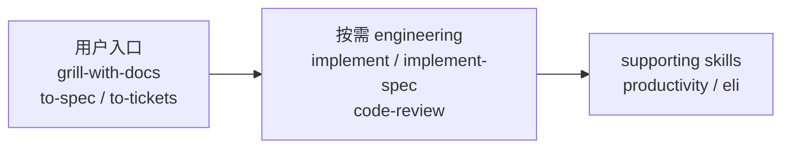
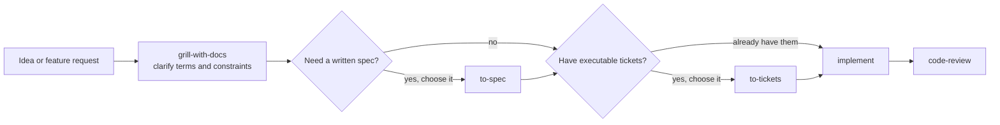
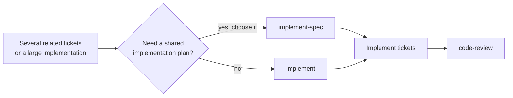
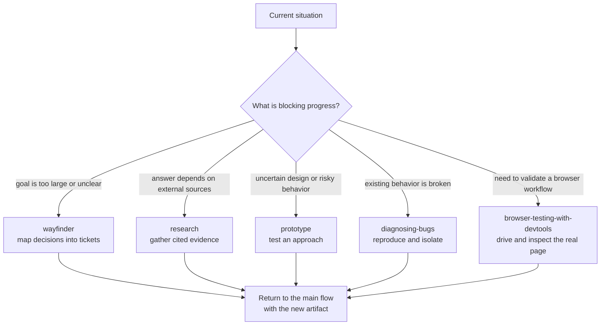

# ys-powers

`ys-powers` 为 coding agent 提供一套以 Matt Pocock skills 为基础、可由用户掌控的本地 workflow。

## 2.0.0 Matt-first workflow

当前 release 是 `2.0.0` Matt-first workflow：保留 Matt 的 skill 内容、frontmatter、调用策略和 `agents/openai.yaml`，只加入必要的本地安装与解释能力。

### Skill layers



- **用户入口**：从问题澄清、spec 到 tickets，形成可执行的任务上下文。
- **按需 engineering**：根据当前产物选择实现、复杂 ticket 实现或 review。
- **supporting skills**：提供上下文、沟通、文档与本地 HTML 解释能力。

以上是能力分层，不是自动调用链；每一步都由用户或 agent 根据当前产物决定是否继续。

### 阅读顺序

1. 先看上面的 skill layers，确认任务处于哪一层。
2. 从用户入口开始，按当前产物选择下一个 skill。
3. 需要工程处理时，再进入按需 engineering；supporting skills 按需要补充。

### Main workflow

```text
grill-with-docs → to-spec → to-tickets → implement → code-review
```

复杂 ticket 可将 `implement` 替换为 `implement-spec`。这两条路径都需要显式选择，不会自动触发下一个 skill。

### Scenario navigation

Choose the next skill from the artifact or situation you have now; the diagrams
are a menu, not an automatic chain.

#### Ordinary feature



`grill-with-docs` only sharpens the idea and records decisions. It does **not**
automatically call `to-spec`; choose `to-spec` when the current situation needs
a spec, and choose `to-tickets` when the spec needs to become executable work.

#### Multi-ticket implementation



`implement-spec` is an explicit choice for coordinating multiple tickets; it
is not a replacement that `to-tickets` or `grill-with-docs` invokes for you.

#### On-demand branches



These branches are selected when their situation applies. They produce
evidence, a prototype, a diagnosis, or a validated browser result that you can
then bring back to the main workflow; they do not silently trigger another
skill.

## 项目初始化

第一次在项目中使用 Matt engineering skills 时，调用 `setup-matt-pocock-skills`。安装器会将当前 skills 安装到 `<project>/.claude/skills/`。

```bash
make local-install
make local-install project-dir=/path/to/project
```

## 当前目录

```text
skills/engineering/   主流程与按需工程能力
skills/productivity/  上下文、沟通与文档能力
skills/eli/           本地 HTML 解释能力
install/              本地与全局安装器
```

`deprecated/`、`in-progress/`、`misc/` 不属于当前使用范围；`refer/` 是只读的上游参考仓库。
