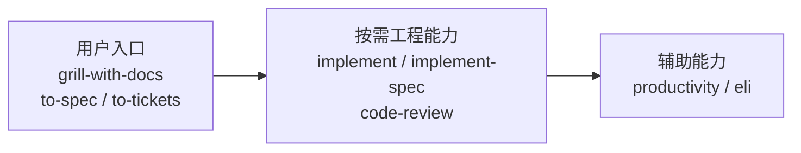
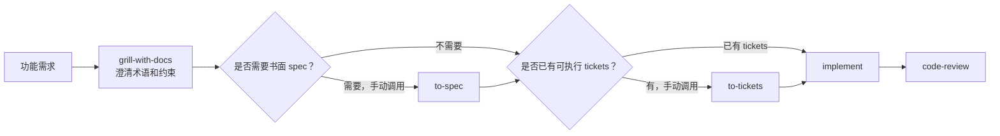
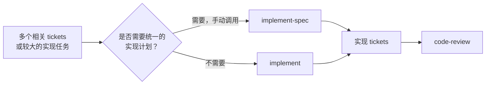
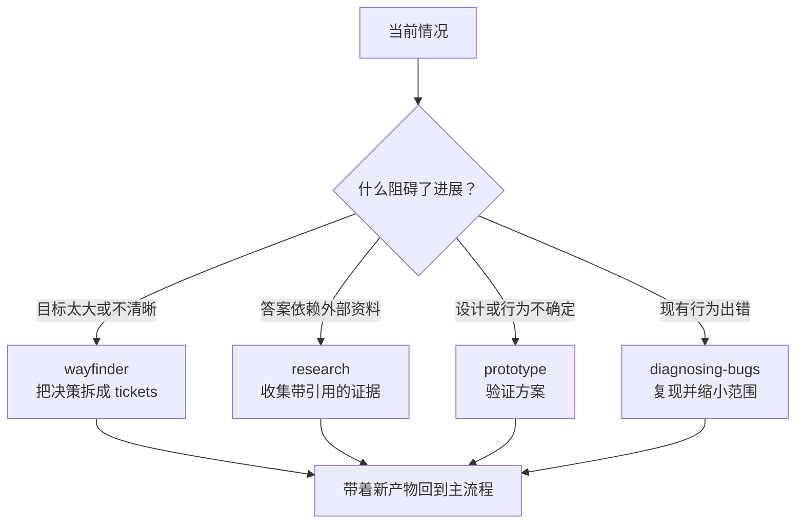

# ys-powers

`ys-powers` 为 coding agent 提供一套以 Matt Pocock skills 为基础、由用户掌控的本地 workflow。

## 2.0.0：以 Matt 为核心的 workflow

当前 release 是 `2.0.0` Matt-first workflow：保留 Matt 的 skill 内容、frontmatter、调用策略和 `agents/openai.yaml`，并按来源隔离 Matt、pstack 与 local skills。

### Skill 分层



- **用户入口**：从问题澄清、spec 到 tickets，形成可执行的任务上下文。
- **按需工程能力**：根据当前产物选择实现、复杂 ticket 实现或 code review。
- **辅助能力**：提供上下文、沟通、文档与本地 HTML 解释能力。

以上是能力分层，不是自动调用链；每一步都由用户或 agent 根据当前产物决定是否继续。
当前 source tree 按来源组织，安装时统一扁平复制到 `.claude/skills/<skill-name>/`：

- `skills/matt/engineering`：Matt engineering skills。
- `skills/matt/productivity`：Matt productivity skills。
- `skills/pstack`：从 Cursor pstack 独立引入或改编的 skills。
- `skills/local`：ys-powers 直接维护的 skills。

不同来源出现同名 skill 时，installer 会在复制前失败，不按目录顺序静默覆盖。各来源的 upstream、pinned commit 与同步边界记录在对应目录的 `README.md`。

### 阅读顺序

1. 先看上面的 Skill 分层，确认任务处于哪一层。
2. 从用户入口开始，按当前产物选择下一个 skill。
3. 需要工程处理时，再进入按需工程能力；辅助能力按需要补充。

### 主流程

```text
grill-with-docs → to-spec → to-tickets → implement → code-review
```

复杂 ticket 可将 `implement` 替换为 `implement-spec`。这两条路径都需要显式选择，不会自动触发下一个 skill。

### 场景导航

根据当前已有的产物或遇到的问题选择下一个 skill；这些图是选择菜单，不是自动调用链。

#### 普通功能



`grill-with-docs` 只负责澄清想法并记录决策，**不会**自动调用 `to-spec`；当当前结果需要 spec 时再手动调用 `to-spec`，当 spec 需要转成可执行工作时再手动调用 `to-tickets`。

#### 多 ticket 实现



`implement-spec` 用于协调多个 tickets，是一个明确的手动选择；`to-tickets` 或 `grill-with-docs` 都不会自动调用它。

#### 按需分支



这些分支只在对应场景出现时手动调用。它们会产出证据、prototype 或 bug diagnosis，再带回主流程；不会静默触发其他 skill。

## 快速开始

### 1. 安装 skills

在本仓库目录执行以下 Makefile target：

```bash
# 当前项目
make local-install

# 指定项目
make local-install project-dir=/path/to/project

# 全局安装
make global-install
```

这些命令会安装当前支持的 skill 分组。`project-dir` 是 Make 变量，不要把它作为位置参数传入。

### 2. 每个项目只需 setup 一次

在目标项目中先执行一次 `setup-matt-pocock-skills`，然后再使用 engineering skills。它会配置各个 skill 共享的项目上下文。

setup 流程可以选择启用文档语言规则：新写或修改的技术文档以中文为主，同时保留 English technical terms、domain names、code identifiers、file paths、commands 和 configuration values。已有文档不会被重写。

完成 setup 后，根据上面的 workflow 图，按照当前已有的产物或遇到的问题选择 skill。图示是选择菜单，不是自动调用链。
