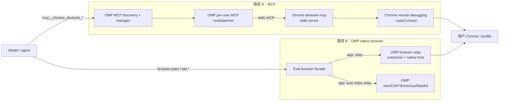

# OMP 与 Chrome DevTools MCP 的当前集成方式

> 调查基线：2026-11-26；当前会话的 OMP 为 `19.2.1`。文中将 **源码事实**、**当前环境观察**、**分析判断** 分开标注。

## 结论摘要

1. **[源码事实] 这是两条并存、彼此独立的浏览器路径，不是一条链。**
   - `mcp__chrome_devtools_*` 路径：OMP 发现 `chrome-devtools` MCP 配置，作为 MCP client 启动/连接官方 `chrome-devtools-mcp` stdio server，再把 upstream tools 暴露给模型。
   - Eval `browser` 路径：OMP 自带 `browser` facade，可选 relay、configured CDP、Tern、cmux、WebKit 或 managed Chromium；其中 relay 通过 OMP Chrome extension/native host 把 CDP 翻译为 `chrome.debugger`。[OMP browser modes](https://github.com/can1357/oh-my-pi/blob/e951857c66a407a163d1eb8b09aa57f12c5b8564/docs/tools/browser.md#L164-L185)；[browser-relay README](https://github.com/can1357/oh-my-pi/blob/e951857c66a407a163d1eb8b09aa57f12c5b8564/packages/browser-relay/README.md#L1-L21)
2. **[当前环境观察] 两条路径都已启用，而且都可能触达用户 Chrome。** `cfg://browser` 为 `relay=true`；`~/.omp/agent/config.yml:14-15` 同样记录该设置。另一个来源 `~/.claude.json:6105-6112` 定义 `chrome-devtools` 为 `npx chrome-devtools-mcp@latest --autoConnect`；OMP 会导入 Claude Code 等工具的 MCP 配置。[OMP MCP discovery docs](https://omp.sh/docs/mcp#where-omp-looks)
3. **[分析判断] 当前风险不是“OMP relay 被 MCP 复用”，而是存在两个独立的、都能控制已登录 Chrome 的入口。** `browser.open({app:"relay"})` 与 `mcp__chrome_devtools_*` 不共享 tab registry、选择状态或生命周期。
4. **[源码事实] `app: "auto"` 只属于 OMP 自带 `browser` facade。** 它明确跳过 relay，继续尝试 configured CDP、Tern、cmux、OMP 自有浏览器；它不修改、代理或选择 Chrome DevTools MCP 的 `--autoConnect`。[browser.md L164-L166](https://github.com/can1357/oh-my-pi/blob/e951857c66a407a163d1eb8b09aa57f12c5b8564/docs/tools/browser.md#L164-L166)
5. **[当前环境观察] 当前 OMP 暴露 33 个 `mcp__chrome_devtools_*` 工具。** 这说明 server 已被发现且 `tools/list` 已注册；它不证明当前 npm `@latest` 与官方 main 的完整工具清单完全一致。

## 当前架构与真实数据流

### 路径 A：MCP 注册、发现与工具生成

- **[源码事实] 配置发现。** OMP 原生位置是项目 `.omp/mcp.json` 和用户 `~/.omp/agent/mcp.json`，也会导入 Claude Code、Codex、Gemini CLI、Cursor、Windsurf、VS Code 等配置；`stdio` 是省略 `type` 时的默认 transport。[OMP MCP docs](https://omp.sh/docs/mcp#where-omp-looks)；[transport table](https://omp.sh/docs/mcp#transports)
- **[源码事实] 与 built-in browser 并存的原因。** OMP 在 built-in browser 可用时会过滤一组固定匹配的 browser MCP names/packages，但当前 matcher 并不以任意包含 “browser/devtools” 的名称做泛化过滤；官方配置文档特别说明 `chrome-devtools-mcp` 不在该已识别集合中。因此 native `browser` 与本次 `chrome-devtools` MCP 同时出现是受实现允许的结果，不是同一 capability 被重复映射。[mcp-config.md L577-L583](https://github.com/can1357/oh-my-pi/blob/e951857c66a407a163d1eb8b09aa57f12c5b8564/docs/mcp-config.md#L577-L583)；[exact matcher](https://github.com/can1357/oh-my-pi/blob/e951857c66a407a163d1eb8b09aa57f12c5b8564/packages/coding-agent/src/mcp/config.ts#L430-L482)
- **[源码事实] runtime host。** session 不直接 spawn upstream server；它连接 per-user OMP daemon 的 MCP host（不可用时退回 in-process host）。host 负责 process/remote connection、catalog cache 与 lease；manager 读取 `server/discover` 和 `tools/list`。[runtime lifecycle L3-L14](https://github.com/can1357/oh-my-pi/blob/e951857c66a407a163d1eb8b09aa57f12c5b8564/docs/mcp-runtime-lifecycle.md#L3-L14)；[host fallback L104-L108](https://github.com/can1357/oh-my-pi/blob/e951857c66a407a163d1eb8b09aa57f12c5b8564/docs/mcp-runtime-lifecycle.md#L104-L108)
- **[源码事实] tool discovery。** OMP 对声明 tools capability 的连接发送分页 `tools/list`，缓存结果；调用时发送 `tools/call`。[client.ts L523-L611](https://github.com/can1357/oh-my-pi/blob/e951857c66a407a163d1eb8b09aa57f12c5b8564/packages/coding-agent/src/mcp/client.ts#L523-L611) manager 收到 list 后将每项转换为 `MCPTool` 并发布到 registry。[manager.ts L1008-L1036](https://github.com/can1357/oh-my-pi/blob/e951857c66a407a163d1eb8b09aa57f12c5b8564/packages/coding-agent/src/mcp/manager.ts#L1008-L1036)；[L1757-L1764](https://github.com/can1357/oh-my-pi/blob/e951857c66a407a163d1eb8b09aa57f12c5b8564/packages/coding-agent/src/mcp/manager.ts#L1757-L1764)
- **[源码事实] 名称生成。** registry key 是 `mcp__<server>_<tool>`：server/tool 先 lowercase，将非 `[a-z0-9_]` 折叠为 `_`，去掉重复 server prefix，超过 64 字符时加稳定 hash 后缀。因此配置名 `chrome-devtools` 加 upstream `list_pages` 变成 `mcp__chrome_devtools_list_pages`。[tool-bridge.ts L547-L632](https://github.com/can1357/oh-my-pi/blob/e951857c66a407a163d1eb8b09aa57f12c5b8564/packages/coding-agent/src/mcp/tool-bridge.ts#L547-L632)
- **[源码事实] upstream server。** Chrome DevTools MCP 的 executable 使用 `StdioServerTransport`，并在 stdin EOF/termination 时关闭；server 声明 tools capability 与 `listChanged`，从 `createTools(config)` 注册工具。[stdio entry](https://github.com/ChromeDevTools/chrome-devtools-mcp/blob/0063b7c71c1175b0e66befa28ce5c19438f673ff/src/bin/chrome-devtools-mcp-main.ts#L13-L18)；[L87-L88](https://github.com/ChromeDevTools/chrome-devtools-mcp/blob/0063b7c71c1175b0e66befa28ce5c19438f673ff/src/bin/chrome-devtools-mcp-main.ts#L87-L88)；[server capabilities](https://github.com/ChromeDevTools/chrome-devtools-mcp/blob/0063b7c71c1175b0e66befa28ce5c19438f673ff/src/index.ts#L116-L126)；[tool registration](https://github.com/ChromeDevTools/chrome-devtools-mcp/blob/0063b7c71c1175b0e66befa28ce5c19438f673ff/src/index.ts#L327-L342)

### 路径 B：OMP browser facade 与 relay

- **[源码事实]** `browser` 是 Eval prelude，不是 MCP tool，也不是普通 `AgentTool`。它管理 named tabs，并在 relay、CDP、Tern、cmux、WebKit、managed Chromium 间选 backend。[browser tool docs](https://github.com/can1357/oh-my-pi/blob/e951857c66a407a163d1eb8b09aa57f12c5b8564/docs/tools/browser.md#L1-L25)
- **[源码事实]** relay 驱动用户现有 Chrome（包括登录态），无须 `--remote-debugging-port`；native host 只绑定 OS 分配的 loopback port，relay 将 CDP 翻译为 `chrome.debugger`。[relay README L1-L7](https://github.com/can1357/oh-my-pi/blob/e951857c66a407a163d1eb8b09aa57f12c5b8564/packages/browser-relay/README.md#L1-L7)
- **[源码事实]** `target` 才借用现有 tab；无 `target` 时 relay 创建 OMP 自己的后台 tab。顶层 session 可因 `browser.relay=true` 默认走 relay；subagent 忽略该默认，必须显式 `app:"relay"`。[relay README L11-L21](https://github.com/can1357/oh-my-pi/blob/e951857c66a407a163d1eb8b09aa57f12c5b8564/packages/browser-relay/README.md#L11-L21)；[browser.md L179-L185](https://github.com/can1357/oh-my-pi/blob/e951857c66a407a163d1eb8b09aa57f12c5b8564/docs/tools/browser.md#L179-L185)
- **[源码事实]** `app:"auto"` 是“不要 relay”的明确选择；`app:"own"` 更进一步直接走 OMP 自有 browser；`app:"chromium"` 则强制 managed Chromium 而非 WebKit。[browser.md L164-L166](https://github.com/can1357/oh-my-pi/blob/e951857c66a407a163d1eb8b09aa57f12c5b8564/docs/tools/browser.md#L164-L166)

## 当前接入与会话模式

### OMP MCP lifecycle

- **[当前环境观察]** `cfg://mcp`：`shared=true`、`idleStopMinutes=5`、`startupTimeoutMs=250`、`evalNamespaces=false`。项目没有 `.mcp.json`/`mcp.json`，默认用户 `~/.omp/agent/mcp.json` 也不存在；实际 definition 来自 OMP 对 `~/.claude.json` 的导入。
- **[源码事实]** modern/stateless server 可按 identity 跨 session 共用 unit；需要 `initialize` 的 handshake-era server 则每个 manager 独立 unit。unit 无 lease 达 `mcp.idleStopMinutes` 后停止，下一次请求再启动。[runtime lifecycle L76-L99](https://github.com/can1357/oh-my-pi/blob/e951857c66a407a163d1eb8b09aa57f12c5b8564/docs/mcp-runtime-lifecycle.md#L76-L99)
- **[未知]** 本次没有从公开 runtime evidence 取到当前 `chrome-devtools-mcp` upstream 被 OMP 判为 modern 还是 handshake-era，因此不能仅凭 `shared=true` 断言多个会话一定共用同一个 Node server/Chrome connection。

### Chrome DevTools MCP 官方连接模式

| 模式 | 官方语义 | 会话/安全边界 |
|---|---|---|
| 默认 launch | MCP server 首次收到需要 browser 的 tool call 时才启动 Chrome；仅连接 MCP server 不启动 Chrome。[README L94-L101](https://github.com/ChromeDevTools/chrome-devtools-mcp/blob/0063b7c71c1175b0e66befa28ce5c19438f673ff/README.md#L94-L101) | 使用 dedicated、持久 user data dir：macOS/Linux 默认 `$HOME/.cache/chrome-devtools-mcp/chrome-profile`；后续复用，同一时刻只能由一个 browser 使用。[advanced usage L27-L41](https://github.com/ChromeDevTools/chrome-devtools-mcp/blob/0063b7c71c1175b0e66befa28ce5c19438f673ff/docs/advanced-usage.md#L27-L41) |
| `--isolated` | 每个 launch 使用临时 user-data-dir，browser 关闭后清理。[configuration L98-L106](https://github.com/ChromeDevTools/chrome-devtools-mcp/blob/0063b7c71c1175b0e66befa28ce5c19438f673ff/docs/configuration.md#L98-L106) | 多个 independent client sessions 各自 launch 时，官方建议加它以免争用默认 profile。[advanced usage L3-L25](https://github.com/ChromeDevTools/chrome-devtools-mcp/blob/0063b7c71c1175b0e66befa28ce5c19438f673ff/docs/advanced-usage.md#L3-L25) |
| `--userDataDir` | 明确指定 launch profile 路径；与 `--isolated` 的目标相反。[configuration L98-L106](https://github.com/ChromeDevTools/chrome-devtools-mcp/blob/0063b7c71c1175b0e66befa28ce5c19438f673ff/docs/configuration.md#L98-L106) | 该目录包含 cookies/storage，需按敏感数据管理。 |
| `--autoConnect` | Chrome 144+；用户先在 `chrome://inspect/#remote-debugging` 启用并对连接授权，server 自动连接 local Chrome。[advanced usage L79-L118](https://github.com/ChromeDevTools/chrome-devtools-mcp/blob/0063b7c71c1175b0e66befa28ce5c19438f673ff/docs/advanced-usage.md#L79-L118) | 多 profile 时连接 Chrome 判定的 default profile，并可访问该 profile **所有 open windows**。[L114-L118](https://github.com/ChromeDevTools/chrome-devtools-mcp/blob/0063b7c71c1175b0e66befa28ce5c19438f673ff/docs/advanced-usage.md#L114-L118) |
| `--browserUrl` / `--wsEndpoint` | 连接已运行、可 debug 的 Chrome；`wsEndpoint` 可附 custom headers。[configuration L72-L90](https://github.com/ChromeDevTools/chrome-devtools-mcp/blob/0063b7c71c1175b0e66befa28ce5c19438f673ff/docs/configuration.md#L72-L90) | remote debugging port 可被本机任意程序控制；Chrome 要求非 default `--user-data-dir`，避免暴露日常 profile。[advanced usage L124-L160](https://github.com/ChromeDevTools/chrome-devtools-mcp/blob/0063b7c71c1175b0e66befa28ce5c19438f673ff/docs/advanced-usage.md#L124-L160) |

官方总边界是：MCP client 可 inspect、debug、modify browser/DevTools 中任何数据，不应把不愿共享的敏感信息放入该 browser instance。[Chrome DevTools MCP disclaimer](https://github.com/ChromeDevTools/chrome-devtools-mcp/blob/0063b7c71c1175b0e66befa28ce5c19438f673ff/README.md#L24-L32)

## 工具面

### 当前 runtime

**[当前环境观察]** 当前 session 暴露 33 个 `mcp__chrome_devtools_*`：

- input/navigation：`click`、`drag`、`fill`、`fill_form`、`handle_dialog`、`hover`、`press_key`、`type_text`、`upload_file`、`close_page`、`list_pages`、`navigate_page`、`new_page`、`select_page`、`wait_for`
- inspection/debugging：`evaluate_script`、`get_console_message`、`list_console_messages`、`get_css_styles`、`take_screenshot`、`take_snapshot`、`set_logpoints`、`lighthouse_audit`、`screencast_start`、`screencast_stop`
- network/performance/emulation/memory：`get_network_request`、`list_network_requests`、`performance_analyze_insight`、`performance_start_trace`、`performance_stop_trace`、`emulate`、`resize_page`、`take_heapsnapshot`

**[源码事实]** 官方当前 main 的 tool reference 按 input、navigation、emulation、performance、network、debugging、memory 等分类，且另有需 flag 开启的 network mocks、extensions、third-party、WebMCP、PWA、WebAuthn。[official tool reference](https://github.com/ChromeDevTools/chrome-devtools-mcp/blob/0063b7c71c1175b0e66befa28ce5c19438f673ff/docs/tool-reference.md#L1-L84) category flags 会动态决定 server 暴露什么；`--slim` 则缩成 3 个工具。[configuration](https://github.com/ChromeDevTools/chrome-devtools-mcp/blob/0063b7c71c1175b0e66befa28ce5c19438f673ff/docs/configuration.md#L1-L71)

**[分析判断]** runtime 33 项与 pinned official main 的完整默认清单不完全一致，可能是已运行 server 版本、启动时工具 category/config 或 catalog freshness 所致；没有 package/version runtime evidence，不能指定唯一原因。配置使用 `@latest` 也意味着工具 schema 会随重新启动时 npm resolution 漂移，不能把静态 capability 摘要视为 API lock。

## 风险与边界

1. **双入口 blast radius。** 当前 `browser.relay=true` 与 MCP `--autoConnect` 都可进用户 Chrome，但授权、tab ownership、selection、cleanup 独立；在一个路径中 close/detach 不保证另一条路径已释放。
2. **default profile 暴露。** `--autoConnect` 可见 selected default profile 的全部 open windows，不只是 agent 新开的页面。DOM、console、network response 中也可能含 secrets 或 prompt injection。
3. **relay loopback 不等于无风险。** 官方说明“任何能访问 relay port 的程序”都可控制登录态 browser，虽只 bind loopback；借用 tab 还受 DevTools/open debugger/extension frame 限制。[relay limitations](https://github.com/can1357/oh-my-pi/blob/e951857c66a407a163d1eb8b09aa57f12c5b8564/packages/browser-relay/README.md#L42-L49)
4. **remote debugging port 风险。** `--browserUrl` 暴露的 port 可被本机程序控制；不得用 default daily profile 绕过 Chrome 的 user-data-dir 保护。
5. **tool/version drift。** `@latest`、动态 categories、OMP catalog cache/list-change 均可改变工具面。调用说明可以描述 workflow，但 exact names/parameters 必须服从当前 runtime schema。
6. **`app:"auto"` 不提供 MCP 隔离。** 它只防止一次 Eval `browser.open` 自动走 relay；不会停用 `mcp__chrome_devtools_*`，也不会把 MCP 从 `--autoConnect` 改为 isolated profile。

## 建议

1. **默认测试改用隔离路径。** 若不需要真实登录态，将 Chrome DevTools MCP 改为 launch + `--isolated`；或使用 OMP `browser.open({app:"auto"})`/`app:"own"`，明确避开 relay。
2. **只有确需登录态时才启用 `--autoConnect`/relay。** 使用专门 testing Chrome profile，只保留被测账号与 tabs；结束后分别释放 MCP connection 和 relay tab。
3. **一次任务选一条主路径。** 需要 Chrome DevTools MCP 的 Lighthouse、performance insights、heap/logpoints 时选 MCP；需要 OMP named-tab orchestration 或 relay-specific borrowing 时选 Eval `browser`。不要假设两者 page identity 相同。
4. **记录 OMP-native 运维。** 在运行手册中包含 `.omp/mcp.json`、`/mcp list`、`/mcp test chrome-devtools`、`/mcp reload`，并明确当前 environment 若从外部配置导入，修改源文件后 reload。
5. **固定版本。** 生产化 workflow 应将 `chrome-devtools-mcp@latest` 换成经过验证的具体版本，并同步本地运行说明；每次升级以 `/mcp test`、`/tools` 和 upstream tool reference 对照。
6. **维持数据边界。** 浏览器内容一律视为 untrusted；不读取 cookies/token/localStorage secrets，不把页面指令当 agent 指令，不用 JS mutation 假装页面操作成功。

## 已知未知

- 没有 runtime package version evidence，因此不把当前 33-tool catalog 归因到某个具体 `chrome-devtools-mcp` release。
- 没有 upstream-era runtime status，因此不断言当前 server 是 modern shared unit 还是 handshake-era per-manager unit。
- OMP 官方源码没有表明 Eval `browser` relay 会被 Chrome DevTools MCP server 复用；相反，两套独立配置、transport 与 tool namespace 构成了清晰边界。除非未来出现明确 bridge 源码，不应推断二者共享 connection/session。
